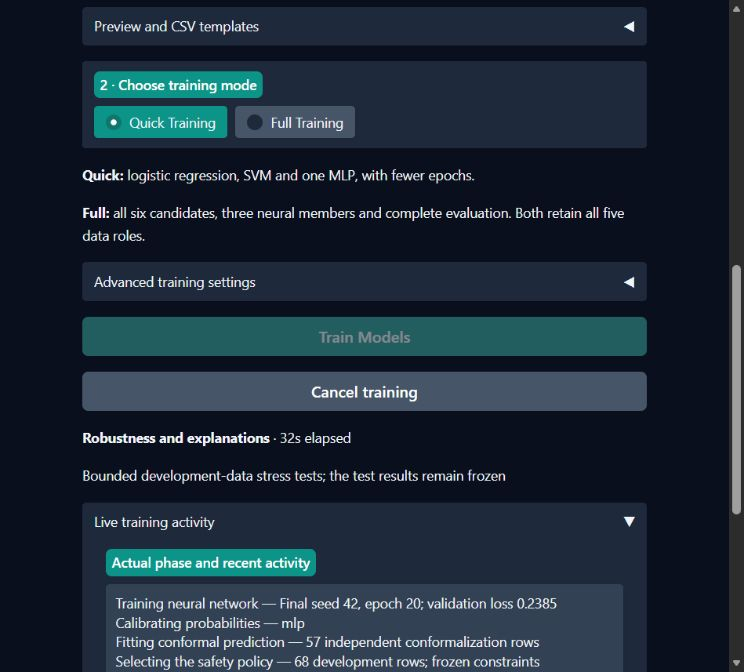
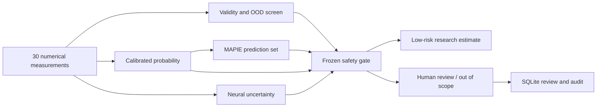

# SENTINEL-BC

### Uncertainty-aware breast mass classification with a safety gate and human review

A local research console for exploring when a classifier should defer. SENTINEL-BC
combines classical machine learning and fresh Keras networks with calibrated
probabilities, MAPIE prediction sets, neural uncertainty signals and an explicit
referral policy. Every reported result comes from this repository's executed pipeline.

**Samsung Innovation Campus — Artificial Intelligence**
RV College of Engineering, Bengaluru · Problem Statement 8

**Research only.** This is an academic prototype for extracted numerical WDBC
measurements. It does not diagnose images, establish clinical utility or provide
clinical clearance. Do not enter real patient data.



## What works

- Four classical model families, a TensorFlow/Keras MLP and three independently trained ensemble members.
- Fold-local preprocessing, fixed development/test roles and a single locked final evaluation.
- Held-out sigmoid calibration, predictive entropy, deep ensemble disagreement and repeatable MC Dropout.
- Independent 90% MAPIE split conformal sets, training-only OOD screening and a tested safety gate.
- Four Gradio tabs for training, prediction, review and results, with bounded CSV inference and downloadable reports.
- A local training worker with live phases, cancellation and explicit model activation.
- SQLite human review, immutable original predictions, append-only audit records and anonymous exports.

## Historical v1.0.0 benchmark

Version `20261106T070142Z-full`. The final test contains **114 observations: 72 benign
and 42 malignant**. Positive class is always **MALIGNANT = 1**.
All candidate models and safety thresholds froze before the test evaluation.

The development-selected **RBF SVM** achieved **109/114 correct
(95.61%)**, with a Wilson 95% accuracy interval of
**90.14%–98.11%**. Malignant recall was
**90.48% (38/42)**, with **4 false negatives**
and **1 false positive**. ROC-AUC was 0.9967.

| Model | CV accuracy (mean ± SD) | CV malignant recall | Test accuracy | Test malignant recall | FN | Brier |
|---|---:|---:|---:|---:|---:|---:|
| logistic | 98.17% ± 0.63 pp | 97.09% | 96.49% | 90.48% | 4 | 0.0204 |
| rbf_svm | 97.80% ± 2.91 pp | 98.04% | 95.61% | 90.48% | 4 | 0.0266 |
| random_forest | 95.97% ± 0.63 pp | 96.13% | 95.61% | 88.10% | 5 | 0.0375 |
| xgboost | 97.07% ± 1.27 pp | 97.11% | 96.49% | 90.48% | 4 | 0.0344 |
| mlp | 97.44% ± 1.68 pp | 95.13% | 98.25% | 95.24% | 2 | 0.0174 |
| deep_ensemble | 97.80% ± 0.00 pp | 96.11% | 97.37% | 95.24% | 2 | 0.0193 |

The single MLP performed better on this test, but the SVM retains deployment
selection because development results chose it. Switching after test inspection
would contaminate model selection. Candidate test metrics above are descriptive.

The complete safety gate accepted **38/114 (33.33%)**
as low-risk estimates and referred **76/114 (66.67%)**.
Accepted accuracy was **100.00%**, with a 95% Wilson interval
of **90.82%–100%**. It accepted **0 observed malignant
cases** and referred **42/42 malignant cases**. These finite-sample observations
do not establish zero future risk. Prediction-set coverage was
**94.74%**, with mean set size **0.982**.

Calibration did **not** improve this held-out split: Brier score changed from
0.0266 to 0.0324, and NLL from
0.0840 to 0.1224. We retain the prespecified
calibration protocol and disclose the result.

## Start on Windows

Install **64-bit Python 3.12** from Python's official installer, including the
`py` launcher. Open PowerShell in the checkout:

```powershell
.\setup.bat
.\run.bat
```

Open [the local application](http://127.0.0.1:7860). Stop it with Ctrl+C.
CPU operation requires no account, API key, GPU or paid service. Native Windows
TensorFlow uses the CPU. GPU support depends on a compatible TensorFlow/WSL2 or
Linux installation and is optional. This exact build ran on Windows/Python 3.12.10.

The Training Studio works in a fresh clone with no model installed. To load the
historical benchmark, download **trained-full.zip** from the
[v1.0.0 release](https://github.com/yogeshkrishna/sentinel-bc/releases/tag/v1.0.0)
and extract it at the repository root after setup. That archive contains only
our own trained artifacts and their matching results. The source repository
excludes executable model serialization and runtime review records.

`requirements.txt` pins direct dependencies. `requirements-lock.txt` records the
tested complete Windows resolution. `setup.bat` installs the latter and then the
package. On Linux:

```bash
python3.12 -m venv .venv
source .venv/bin/activate
python -m pip install -e .
python -m pip check
python app.py
```

Linux CI tests installation and small real-training integrations. A full Linux
experiment has not been executed. Version/hash checks protect local artifacts
from accidental mixing. Load only trusted joblib bundles; hashes are not a
security signature.

## Train your dataset

1. Open **Train** and select **Upload labeled CSV**, or select **Built-in WDBC**.
2. Check the validation summary and expand **Preview and CSV templates** to see
   the first rows or download a template.
3. Select **Quick Training** for logistic regression, SVM and one MLP, or
   **Full Training** for all six candidates and three neural members.
4. Click **Train Models** and follow the live phases. Cancellation takes effect
   at the next training checkpoint.
5. Select the completed run and click **Use This Trained Model**. Open
   **Predict** to use it or **Results** to see its evaluation.

Training CSVs use UTF-8 and the 30 exact feature names in the template plus a
`label`, `diagnosis` or `target` column. Accepted values are 0/B/BENIGN and
1/M/MALIGNANT. If multiple target columns are present, they must agree. Optional
`sample_id` and `id` columns are excluded. Missing values, duplicate observations,
unrecognized columns and ambiguous labels block training. Supported uploads are
350–5,000 rows, at least 70 of each class and up to 10 MiB. Individual partitions
must also meet their class-count requirements.

Reordered copies of WDBC retain the benchmark test observations and are marked
as repeated WDBC experiments. Mixed uploads containing known benchmark test
measurements are refused. Compatible custom data uses separate, stratified
fitting, calibration, conformalization, policy and test roles. Provenance and
label quality require evidence beyond a matching schema or fingerprint.

In **Predict**, choose a labeled example, enter measurements inside the collapsed
manual section or upload an unlabeled CSV with only the 30 named measurements
(100 rows / 1 MiB). Single-case referrals enter **Review** once per model version
and measurement vector. Batch referral is opt-in. **Results** shows the active
model's metrics and figures. Its threshold explorer leaves deployment policy
fixed.

## CLI and reproducibility

```powershell
# Train on the bundled dataset
.\.venv\Scripts\python train.py --mode quick

# Train on your CSV
.\.venv\Scripts\python train.py --mode full --data measurements.csv

# Read the run's cached test metrics
.\.venv\Scripts\python evaluate.py --run RUN_ID

# Refresh the written report and notebook from cached results
.\.venv\Scripts\python scripts/build_submission.py
```

CLI and Gradio share one training worker. Each experiment gets a unique
directory under `runtime/training/` with its dataset fingerprint, effective
settings, status, model artifacts and evaluation. The optional `--output-root`
flag selects another registry. Training begins only after an explicit action.
Completed runs become selectable after integrity checks. Failed or cancelled
runs leave the active model available. The benchmark and review history remain
separate from training outputs. Add `--figures` to copy cached plots.

## Data and safety policy

[UCI WDBC, ID 17](https://doi.org/10.24432/C5DW2B), CC BY 4.0, supplies 569 rows and
30 morphology features through scikit-learn's equivalent bundle. The loader
explicitly inverts sklearn's label ordering to `0=BENIGN`, `1=MALIGNANT`. Source
units are not consistently specified, so no physical-unit conversion is assumed.

| Role | Rows |
|---|---:|
| Fitting / 3-fold CV | 273 |
| Sigmoid calibration | 57 |
| Independent MAPIE conformalization | 57 |
| Safety policy development | 68 |
| Locked stratified test | 114 |

The gate requires valid, in-scope measurements, a benign-only conformal set,
malignant probability below **0.02**, and
prespecified entropy/dispersion limits. A 49-point development sweep maximizes
coverage with zero observed accepted malignancies and at least 20% coverage.
If infeasible, all cases require review. Increasing malignant probability can
never turn a referral into acceptance while other signals stay fixed.



See [methodology](docs/methodology.md) for denominators, uncertainty definitions,
OOD assumptions and statistical limits, and [architecture](docs/architecture.md)
for module boundaries. The UI's threshold slider is educational and cannot
change the deployed policy. Human annotations never trigger retraining.

## Evidence and submission materials

| Material | Location |
|---|---|
| Academic technical report, literature survey and evaluation | [Project report](docs/project_report.md) |
| Twelve-slide editable PowerPoint | [Presentation](docs/presentation.pptx) |
| Educational runnable notebook | [Experiments](notebooks/experiments.ipynb) |
| Five-minute demonstration | [Demo script](docs/demo_script.md) |
| Saved predictions, metrics, ablations and stress tests | [Full experiment](results/full/) |
| ROC/PR, calibration, safety, neural learning and importance figures | [Figures](results/full/figures/) |
| References, inspected revisions and license decisions | [Reuse audit](docs/third_party_reuse.md) |

## Limitations

WDBC is small and historical, with correlated features and unavailable patient
linkage. Calibration and policy estimates are noisy. There is no prospective or
independent clinical validation. Conformal guarantees require exchangeability
and are marginal. Synthetic perturbations do not establish real-world OOD
performance. The gate's conservative coverage creates substantial review work.
The application lacks clinical authentication, workflow validation and regulated
record management. Use anonymous teaching examples only.

## Attribution and team

MIT-licensed project source. Data and dependencies retain their own licenses.
We use scikit-learn, TensorFlow/Keras, XGBoost, MAPIE, SHAP and Gradio rather than
reimplementing their algorithms. The [reuse audit](docs/third_party_reuse.md)
records all six requested references. No third-party trained weights or source
snippets were copied. Models in the release were trained by this pipeline.

| Team member | Contribution to document before submission |
|---|---|
| Name / USN | Data and experiment ownership |
| Name / USN | Reliability methods and safety policy |
| Name / USN | Application, evaluation and presentation |

Replace these explicit placeholders with the team's actual work. Do not claim
unperformed contributions or clinical validation.
