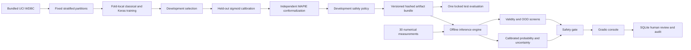

# Architecture

`train.py` owns fitting and freezing. `training.py` coordinates data roles;
`models.py` owns fresh Keras weights and classical candidates. `calibration.py`,
`conformal.py`, `uncertainty.py` and `safety_gate.py` provide small independent
interfaces. `reporting.py` performs one locked evaluation and writes cached
predictions and figures. `evaluate.py` reads that cache.

`Engine` validates the manifest, runtime versions, hashes, schema, required
components and class order before loading a trusted local bundle. It validates
input columns, reorders them canonically, and keeps invalid rows away from the
models. A lock serializes access to Keras inference. Single and batch inference
share the same path. Batch limits are 100 rows and 1 MiB.

`storage.py` preserves original output separately from human annotations.
SQLite transactions commit a review and its audit entry atomically. SQL triggers
prevent ordinary updates to original predictions and audit history. Exports omit
free text and measurements. The UI binds only to 127.0.0.1 by default and never
opens a public tunnel. It has no deployment authentication or clinical record
capabilities.

`configs/default.yaml` is the only experiment configuration. `artifacts/quick`
and `artifacts/full` never mix. Generated model files, runtime databases and
private teaching notes stay out of Git. Published results are small, genuine
research evidence from this public dataset.
